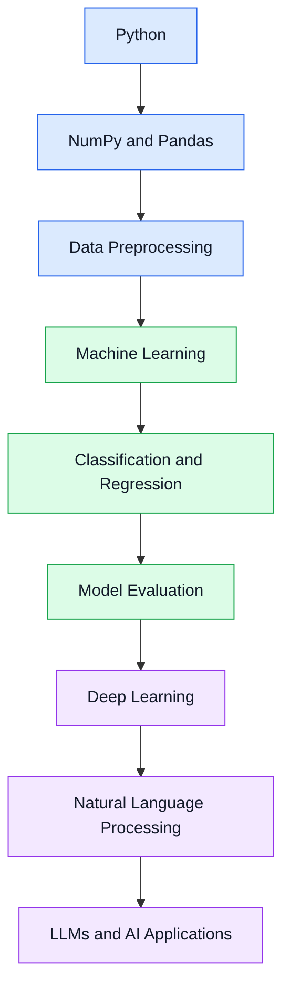
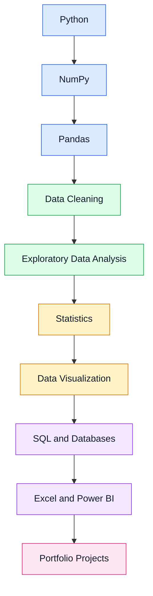
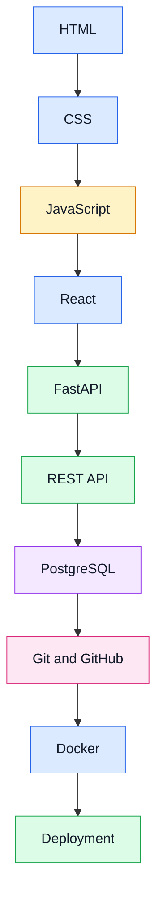

# 👋 I'm Loubna HAMDAOUI

### `Data Analyst` · `AI & Machine Learning` · `Full-Stack Developer`

  

---

## 👩‍💻 About Me

🎓 Recent graduate in **Data Analysis and Decision Support Information Systems**, passionate about Data Analytics, Artificial Intelligence, Machine Learning, and Software Development.

- 📊 Data Analysis and Visualization
- 🤖 Artificial Intelligence, Machine Learning and Deep Learning
- 🐍 Python Programming
- 💻 Full-Stack Development
- 🗄️ SQL and Database Management
- 🚀 Building practical projects and developing technical skills

🌱 Currently learning **Data Analysis, Machine Learning and AI**.

---

## 🛠️ Tech Stack

### 🐍 Programming Languages

### 📊 Data Analysis and Visualization

### 🤖 Artificial Intelligence and Machine Learning

### 🌐 Full-Stack Development

### 🗄️ Databases

### 🔧 Tools and Platforms

---

## 🤖 AI and Machine Learning Roadmap

### From Python Fundamentals to AI Applications

### 🧠 AI Skills

- Machine Learning Fundamentals
- Classification and Regression
- Model Evaluation
- Data Cleaning and Preprocessing
- Exploratory Data Analysis
- Deep Learning Fundamentals
- Natural Language Processing
- LLM and Prompt Evaluation
- AI Data Annotation

---

## 📊 Data Analysis Roadmap

### From Raw Data to Actionable Insights

### 📈 Data Skills

- Data Cleaning and Transformation
- Data Analysis with Pandas
- Numerical Computing with NumPy
- Data Visualization with Matplotlib and Seaborn
- SQL Queries and Database Management
- Statistics Fundamentals
- Exploratory Data Analysis
- Excel and Power BI
- Reporting and Business Insights

---

## 💻 Full-Stack Development Roadmap

### From Web Fundamentals to Application Deployment

### 🌐 Development Skills

- Frontend Development
- Responsive Web Design
- JavaScript Programming
- React Fundamentals
- Backend Development with FastAPI
- REST API Development
- PostgreSQL Database Integration
- Version Control with Git and GitHub
- Docker and Application Deployment

---

## 🌍 Languages

| Language | Level |
|---|---|
| 🇲🇦 Arabic | Native |
| 🇲🇦 Moroccan Arabic (Darija) | Native |
| 🇫🇷 French | Intermediate (B1) |
| 🇬🇧 English | Intermediate (B1) |

---

## 📚 Currently Learning

- 🐍 Python for Data Analysis
- 📊 Pandas, NumPy and Data Visualization
- 🤖 Machine Learning and AI
- 🗄️ SQL and Database Management
- 💻 Full-Stack Development
- 🚀 Building a Professional Portfolio

---

## 📊 GitHub Statistics

  

---

## 🎯 My Goal

**Turning data into insights, building intelligent applications, and developing innovative AI solutions.**

I'm continuously learning, improving my skills, and working toward becoming a strong professional in **Data Analytics, Artificial Intelligence, Machine Learning, and Full-Stack Development**.

---

### 🚀 Keep Learning | Keep Building | Keep Growing

**Thanks for visiting my profile! 💜**

